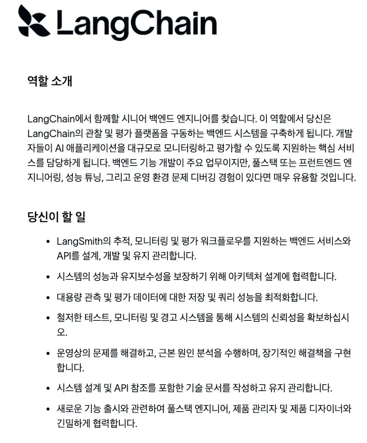

# 2026년 백엔드 사이드 프로젝트 주제 1: LLM 챗봇과 평가 시스템

[LangChain 팀의 백엔드 개발자 채용 공고](https://jobs.ashbyhq.com/langchain/f07c1416-f126-4925-8606-5dd7c5a90f6f/)를 보다가, 백엔드 개발자의 역할이 LLM 시대에 맞춰 점점 넓어지고 있다는 생각이 들었다.

LangChain 팀의 시니어 백엔드 채용 공고는 LLM의 실행 기록을 확인하고 평가를 돌릴 수 있게 API를 만드는 포지션이었다.  
API를 설계하고 데이터를 다루며 서비스를 운영해 온 경험을 LLM 평가 시스템을 만드는 데도 써볼 수 있는 자리였다.

"요즘 백엔드 개발자들은 어떤 걸 사이드 프로젝트로 해보면 좋겠냐"는 질문을 자주 받는다.  
이 공고를 보다가 생각난 건, 코드 구조와 설계를 연습하려고 보편적인 웹 서비스 사이드 프로젝트를 해봤다면 이번에는 작은 LLM 챗봇과 그 챗봇의 평가 시스템을 만들어보면 좋겠다는 것이었다.

사내 문서를 찾아 답하는 챗봇을 만들었다고 해보자.  
문서에 있는 내용을 제대로 답하는지, 문서에 없는 내용은 지어내지 않는지 확인해야 한다.  
프롬프트를 고친 뒤에도 잘 답하던 질문에 계속 잘 답하는지 확인하고, 응답 시간과 토큰 사용량도 함께 봐야 한다.

평가할 질문을 반복해서 실행하고 답변을 채점하는 도구를 만든 뒤, 변경 전후의 결과를 비교할 수 있는 시스템을 만들어보는 것이다.

예전에 웹과 앱 팀을 위한 공통 API를 백엔드 개발자가 만들듯, 지금은 각 팀이 자기 서비스에 맞는 질문과 기준으로 평가를 실행할 수 있는 도구를 만들어서 제공하는 경험을 해보는 것이다.  
(물론 사이드 프로젝트에 웹/앱 개발팀이 따로 있는 건 아니지만)

이런 과정을 무작정 맨땅에 헤딩으로, AI에게만 100% 의존해서 다 해보려고 하면 부담스럽다.  
어찌됐든 최소한의 기본 골격은 제대로 배우고 시작하는 것이 심리적으로 허들이 낮으니깐.  
특히 LLM API는 종량제라서 쓰는 만큼 비용이 나올 수밖에 없어서 이런 시스템을 만들고 테스트하는 데 걱정부터 생긴다.

다행히 로컬 LLM을 이용해서 TypeScript 기반의 작은 FAQ 챗봇을 만들고 이런 평가 과정을 진행하는 강의가 있다.  
Hong 님의 '실리콘밸리 개발자가 알려주는 LLM 평가 하네스 엔지니어링'이다.

- [실리콘밸리 개발자가 알려주는 LLM 평가 하네스 엔지니어링](https://inf.run/WZjsL)

키워드 채점기와 LLM 채점기를 만들고, 질문별 답변과 평가 결과를 저장한다.  
이전 답변과 채점 이유를 함께 보고, 답변을 고칠지 채점 기준을 고칠지 판단해본다.  
사람이 매긴 평가와도 비교하면서 자동 채점 결과를 얼마나 믿고 써도 되는지 점검한다.

답변 생성과 채점 중 어디에서 시간과 토큰을 많이 쓰는지도 단계별 실행 기록으로 확인한다.  
처음 이런 평가 시스템을 만들 때 필요한 작업을 하나씩 해볼 수 있다.

특히나 이 강의는 Ollama로 로컬 모델을 쓰기 때문에, 유료 API 호출 비용을 걱정하지 않고 코드를 바꿔가며 답변과 평가 결과를 충분히 비교해볼 수 있다.

다음 사이드 프로젝트로 LLM 챗봇과 평가 시스템을 함께 만들어보고 싶은 백엔드 개발자분들께 추천드린다.

