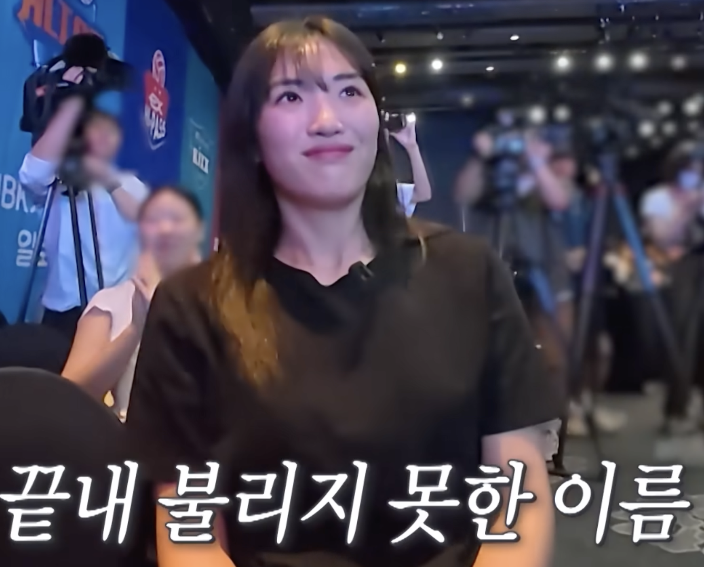
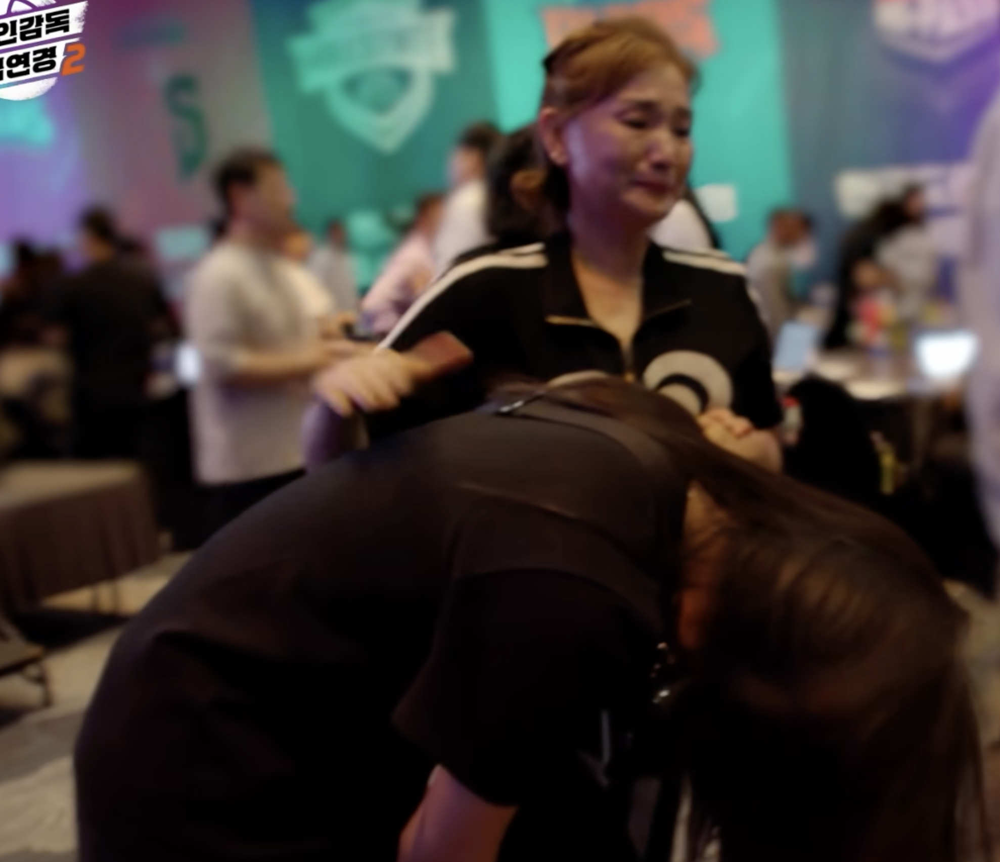

# 좋아하는 것도 습관이다

트레바리에서 "좋아하는 일과 잘하는 일 중에서 어떤 선택을 해야 지속 가능한 성취가 가능한 것인가"라는 주제로 이야기를 나눴다.  
나는 지금 하는 일을 좋아하려고 노력하는 쪽에 더 마음이 간다고 이야기했다.
좋아하는 일을 찾았더라도, 그 일을 직업으로 계속할 수 있는지는 내 마음만으로 결정되지 않기 때문이다.

---

최근에 '신인감독 김연경' 시즌 2가 시작되었다.  
이 프로그램에는 [프로팀에서 방출된 선수들과 프로 진출을 꿈꾸는 실업팀 선수들](https://m.imbc.com/program/concept/1006834100000100000)이 나온다.  

시즌 2에서는 시즌 1 선수들의 후일담도 볼 수 있었다.
그중 윤영인 선수가 다시 프로 드래프트에 참여한 장면이 기억에 남는다.
시즌 1에서 활약했던 선수라 이번에는 프로 구단의 선택을 받기를 기대했다.
하지만 마지막까지 윤영인 선수의 이름은 불리지 않았다.

그리고 윤영인 선수는 시즌 2에 다시 참가했다.  
그 장면을 보면서, 좋아하는 마음만으로는 원하는 일을 직업으로 삼을 수 없다는 생각이 들었다.
나는 지금 좋아하는 일을 하고 있지만, 앞으로도 계속할 수 있을까?

---

코드를 사랑하는 사람에게는 요즘의 변화가 너무 힘들다.  
  
코드 한 줄 한 줄에 감동받고, 그런 코드를 직접 작성하는 일을 사랑했다.  
하지만 지금의 나는 예전처럼 코드를 작성하고 다듬는 일에만 집중하기는 어렵다.  

AI 시대가 오기 전부터 조직에서 코드를 작성하는 일 외에도 여러 일을 맡고 있었다.  
AI 시대가 오면서는 더 다양한 일을 맡게 되었다.  
내가 해야 하는 일도, 나에게 기대하는 역할도 달라지고 있다.  

내가 좋아하고 사랑하는 일이 지금은 직업이 될 수 있어도, 앞으로는 그렇지 않을 수 있다.  
나는 여전히 그 일을 좋아하는데, 그 일을 필요로 하는 곳이나 그 일에 돈을 지불하려는 사람이 줄어들 수도 있다.  

그럼 나는 어떡해야 할까.  
내가 좋아했던 방식으로 계속 일할 수 있는 회사를 찾을 때까지 이직해야 할까?
아니면 그런 환경을 직접 만들기 위해 창업해야 할까?  
  
그것도 선택할 수 있는 방법이다.  
하지만 회사를 옮기거나 직접 만든다고 해서, 내가 좋아하는 일을 계속할 수 있는 조건까지 모두 내 뜻대로 정할 수 있는 것은 아니다.  
창업을 하더라도 내가 하고 싶은 일과 고객이 돈을 지불하고 싶은 일이 같을지는 또 다른 문제다.  
  
좋아하는 일을 찾는 것은 중요하다.  
다만 **좋아하는 일을 찾았다고 해서, 그 일을 직업으로서 계속할 수 있을지에 대한 고민까지 해결되는 것은 아니다.**  
  
그 직업이 더이상 필요하지 않을수도,  
그 직업이 주는 경제적인 보상으로는 생활을 영위하기 힘들 수도 있으니 말이다.  
  
그래서 내가 좋아하는 일을 계속 찾기 위해 노력하기 보다는 지금 하는 일을 좋아하는 것에 더 많은 힘을 쓰려고 노력한다.  

나는 오래 성취감을 느끼면서 행복하게 일하고 싶다.  
새로운 일을 맡을 때마다 예전에 하던 일과 비교하며, 내가 좋아하는 일이 아니라는 이유로 재미없이 일하고 싶지는 않다.  
처음에는 기대하지 않았던 일이라도, 해보면서 좋아하게 될 수 있었으면 한다.  

---

예전처럼 코드 한 줄 한 줄에 감동받고 사랑하는 것은 지금의 내가 하기는 어렵다.  
그렇지만 그 외에도 사랑스럽게 볼 수 있는 일들은 많다.  

세일즈도, 마케팅도, 콘텐츠등 코드와 제품 밖에서 벌어지는 많은 일을을 고민하고 있다.  
그 일들을 사랑하고 있다.  
사랑하려고 노력하고 있다.  
  
**좋아하는 것도 습관이다**.  
좋아해보기로 마음먹고, 좋은 점을 찾고, 더 재미있게 할 방법을 시도해본다.
이런 노력을 반복하는 것도 습관이 될 수 있다고 본다.  
  
지금의 변화도 내가 하는 일을 좋아하는 연습을 하는 시간으로 받아들이고 있다.
새로운 업무를 배우는 것뿐 아니라, 처음 해보는 일을 어떻게 좋아하게 될 수 있는지도 알아가는 시간으로.  
  
언젠가 내 의지와 상관없이 지금 하는 일을 더는 못 하게 되더라도, 그때 새롭게 하는 일에서 재미와 성취감을 느낄 수 있었으면 한다.
가장 좋아했던 일을 하지 못한다고 해서, 앞으로의 직업생활까지 행복하지 않을 것이라고 생각하고 싶지는 않다.  

앞으로도 시대는 계속 바뀔 것이다.
나는 그때그때 바뀌는 내 모든 일들을 사랑하고 싶다.